<h1 align="center"> UltimateHealth Admin </h1>

<h3 align="center">
  <a href="https://git.io/typing-svg">
    
  </a>
</h3>

<div align="center">

[](docs/RELEASE_NOTES_v1.2.0.md)
[](https://ultimatehealth.blog)
[](https://play.google.com/store/apps/details?id=com.anonymous.UltimateHealth)
[](https://ultimatehealth.blog/docs)
[](https://ultimatehealth.blog/content-intel/docs)

</div>

<br/>

<div align="center">
<table>
  <tr>
    <td align="center"><b>🧾 License</b></td>
    <td align="center"><b>🌟 Stars</b></td>
    <td align="center"><b>🍴 Forks</b></td>
  </tr>
  <tr>
    <td align="center"></td>
    <td align="center"></td>
    <td align="center"></td>
  </tr>

  <tr>
    <td align="center"><b>🐛 Issues</b></td>
    <td align="center"><b>🔄 Open PRs</b></td>
    <td align="center"><b>✅ Closed PRs</b></td>
    <td align="center"><b>⏱️ Last Commit</b></td>
  </tr>
  <tr>
    <td align="center"></td>
    <td align="center"></td>
    <td align="center"></td>
    <td align="center"></td>
  </tr>
</table>
</div>

## Maintaining Quality and Trust in Health Information

Accurate and reliable health information is essential for informed decision-making.

**UltimateHealth Admin** is the administrative application for the UltimateHealth platform. It provides content moderators, medical reviewers, and administrators with structured tools to review articles, audit clinical podcasts, evaluate revisions, manage platform abuse, and support a trustworthy health content ecosystem.

### ✨ Key Features

- **Interactive Article Review Workflow** — Approve, reject, or request revisions with inline feedback, clinical guidelines adherence, and real-time status tracking
- **Differential Revision Inspection** — Review requested modifications and side-by-side content changes before approving updates
- **AI-Powered Content & Plagiarism Checker** — Automated grammar correction, originality checking, and quality scoring
- **AI Image & Logo Validation** — Detects unauthorized, low-quality, or inappropriate medical visuals
- **Audio & Podcast Moderation** — Listen to, inspect, and moderate medical audio episodes with series lineage and automated speech verification
- **Incident & Violation Triage** — Track, audit, and resolve user-flagged clinical misinformation and unverified pharmaceutical claims
- **Super Admin Executive Governance** — Platform-wide analytics, staff management with profile dossiers, status toggling, and abuse classifier configuration
- **Doctor Candidate Queue & CV Inspector** — In-app credential inspection and PDF resume review via Google Docs viewer for provisioning medical contributors
- **Interactive Guest Mode & Sandbox** — Full mock dataset allowing evaluators and prospective reviewers to explore queues and test workflows
- **Reviewer Work History Ledger** — Complete personal audit trail of all reviewed articles, revisions, podcasts, and resolved reports

---

## 📱 App Walkthrough & Screenshots

<div align="center">

### 🔐 Authentication & Executive Overview

<table>
  <tr>
    <td align="center" width="33%">
      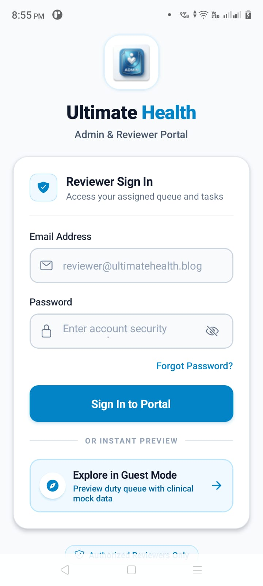<br /><br />
      <b>Reviewer Sign In & Guest Mode</b><br />
      <sub>Secure portal entry and one-tap Guest Mode sandbox exploration with clinical mock data</sub>
    </td>
    <td align="center" width="33%">
      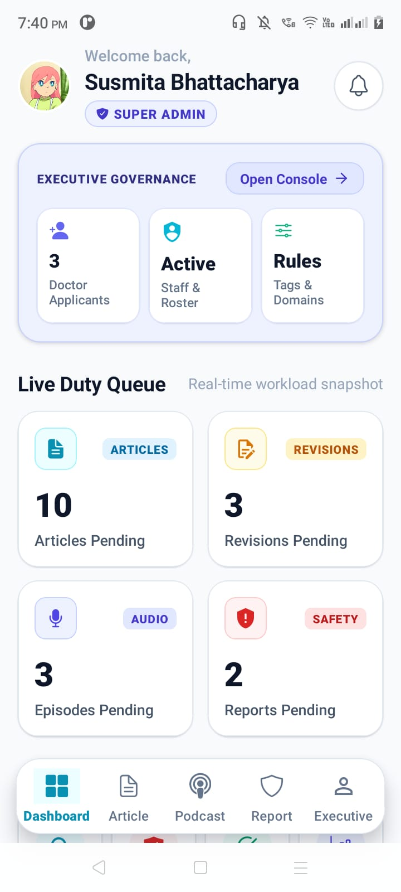<br /><br />
      <b>Admin Dashboard & Live Duty Queue</b><br />
      <sub>Executive governance counters and real-time workload snapshot across all duty streams</sub>
    </td>
    <td align="center" width="33%">
      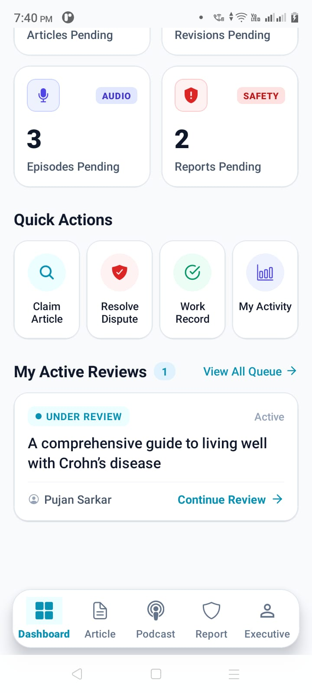<br /><br />
      <b>Quick Actions & Active Reviews</b><br />
      <sub>Direct duty triage shortcuts and real-time "Under Review" article claim tracking</sub>
    </td>
  </tr>
</table>

### 📝 Editorial Pipeline & Differential Revisions

<table>
  <tr>
    <td align="center" width="33%">
      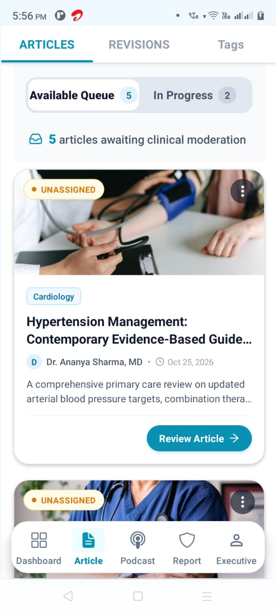<br /><br />
      <b>Article Moderation Queue</b><br />
      <sub>Specialization-categorized queue of submitted clinical articles awaiting review</sub>
    </td>
    <td align="center" width="33%">
      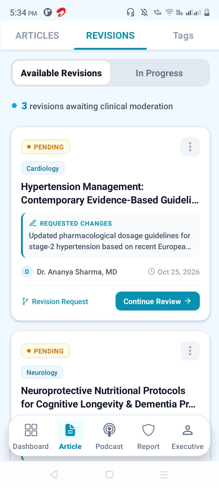<br /><br />
      <b>Revision Review & Diff Tracking</b><br />
      <sub>Audit requested modifications, author revision notes, and clinical guideline changes</sub>
    </td>
    <td align="center" width="33%">
      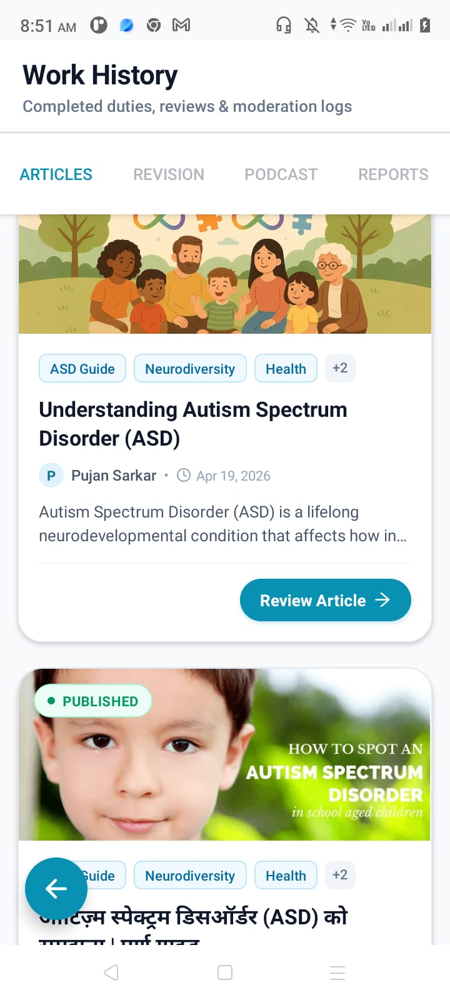<br /><br />
      <b>Work History & Audit Ledger</b><br />
      <sub>Completed duty logs across published articles, approved revisions, podcasts & reports</sub>
    </td>
  </tr>
</table>

### 🎙️ Audio Moderation & Clinical Podcasts

<table>
  <tr>
    <td align="center" width="50%">
      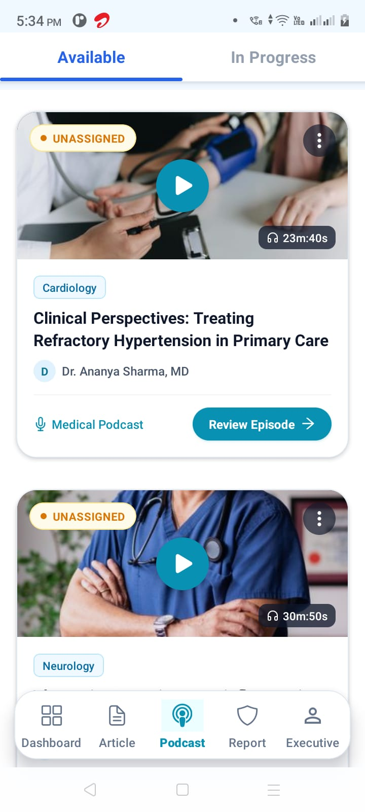<br /><br />
      <b>Medical Podcast Queue</b><br />
      <sub>Clinical audio broadcast review pipeline with duration chips and specialty tags</sub>
    </td>
    <td align="center" width="50%">
      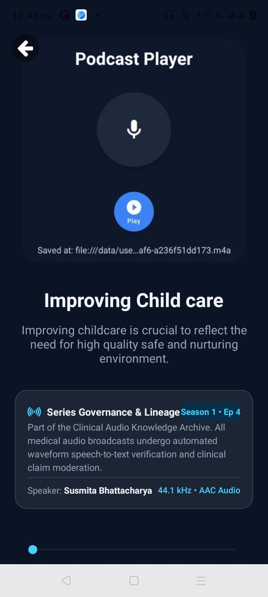<br /><br />
      <b>Podcast Player & Series Governance</b><br />
      <sub>In-app clinical audio player, season/episode lineage, and waveform verification</sub>
    </td>
  </tr>
</table>

### 🛡️ Safety Triage & Super Admin Governance

<table>
  <tr>
    <td align="center" width="33%">
      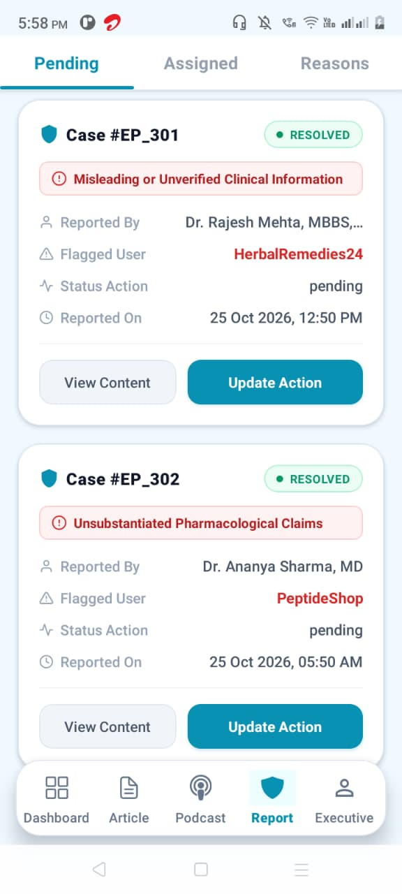<br /><br />
      <b>Incident Reports Triage</b><br />
      <sub>Active abuse cases, misleading claim flags, reporting physician audits & resolutions</sub>
    </td>
    <td align="center" width="33%">
      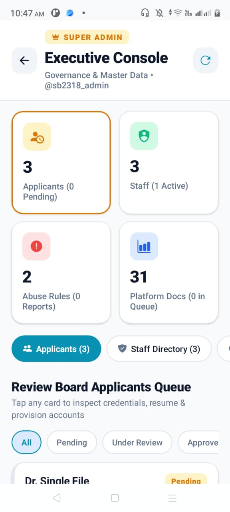<br /><br />
      <b>Doctor Applicants & CV Inspector</b><br />
      <sub>Review board candidate queue, in-app resume inspection & admin account provisioning</sub>
    </td>
    <td align="center" width="33%">
      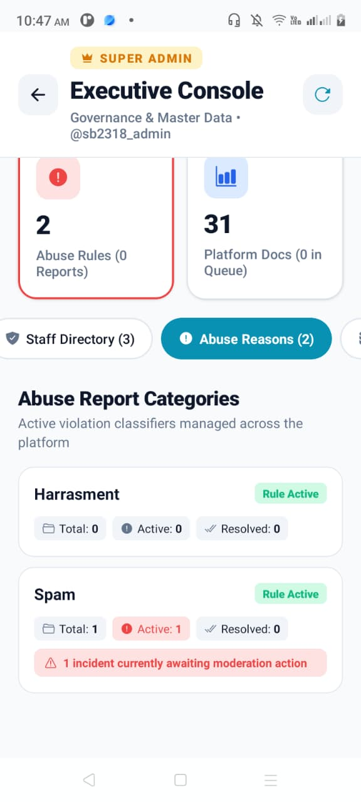<br /><br />
      <b>Abuse Rules & Reason Metrics</b><br />
      <sub>Platform violation rule classifier with real-time active vs. resolved incident metrics</sub>
    </td>
  </tr>
</table>

</div>

---

### Tech Stack

- **Frontend**: React Native (Android + iOS), Expo, TypeScript, Tamagui
- **State Management & Navigation**: Redux Toolkit, React Navigation
- **Backend Services**: Node.js, Express, MongoDB, AWS Lightsail + S3
- **AI/ML Services**: VeriWise Content Checker (Grammar & Plagiarism detection)
- **Real-time Collaboration**: Socket.IO
- **Document & Media Handling**: Expo WebBrowser, Google Docs PDF Viewer, Expo AV

---

## Getting Started ⚡

1. Clone the repo:
   ```bash
   git clone https://github.com/SB2318/ultimatehealth-admin-app.git
   cd ultimatehealth-admin-app
   git checkout main
   ```

2. Frontend (React Native + Expo):
   ```bash
   yarn install
   npx expo prebuild --clean
   npx expo run android # for Android
   npx expo run ios     # for iOS
   ```

## ⚡ Our Vision

We are committed to delivering reliable health information and comprehensive resources that empower individuals to take charge of their well-being. Our mission is to foster a healthier society by providing trustworthy, accessible, and engaging content, enabling users to make informed decisions and lead healthier lives.

## Feedback and Support

If you encounter any issues or have any feedback or suggestions, please open an issue in the Issues section of this repository. We appreciate your feedback and will respond as soon as possible.

---

**Part of the UltimateHealth Ecosystem**

- Main App: [UltimateHealth](https://github.com/SB2318/UltimateHealth)
- Backend: [ultimatehealth-backend](https://github.com/SB2318/ultimatehealth-backend)
- Content Checker: [VeriWise-Content-Check](https://github.com/SB2318/VeriWise-Content-Check)
- Release Notes: [v1.2.0 Release Notes](docs/RELEASE_NOTES_v1.2.0.md)
